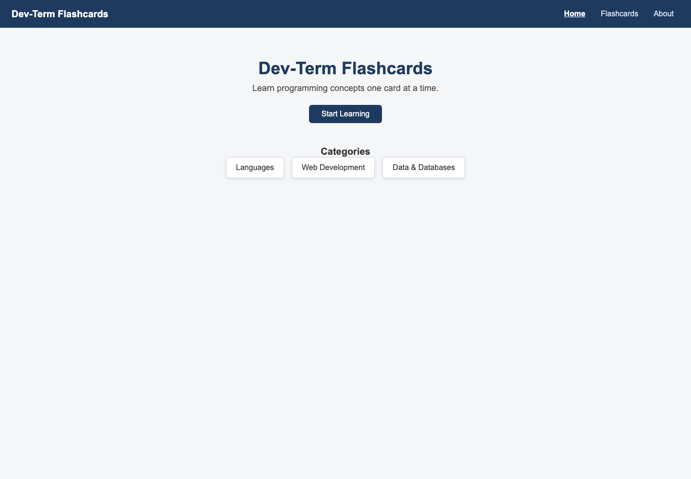
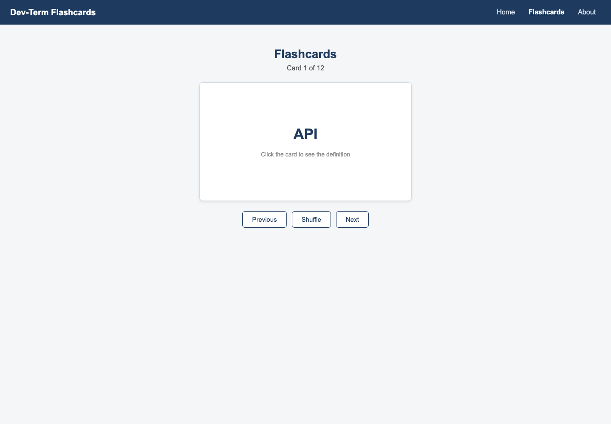
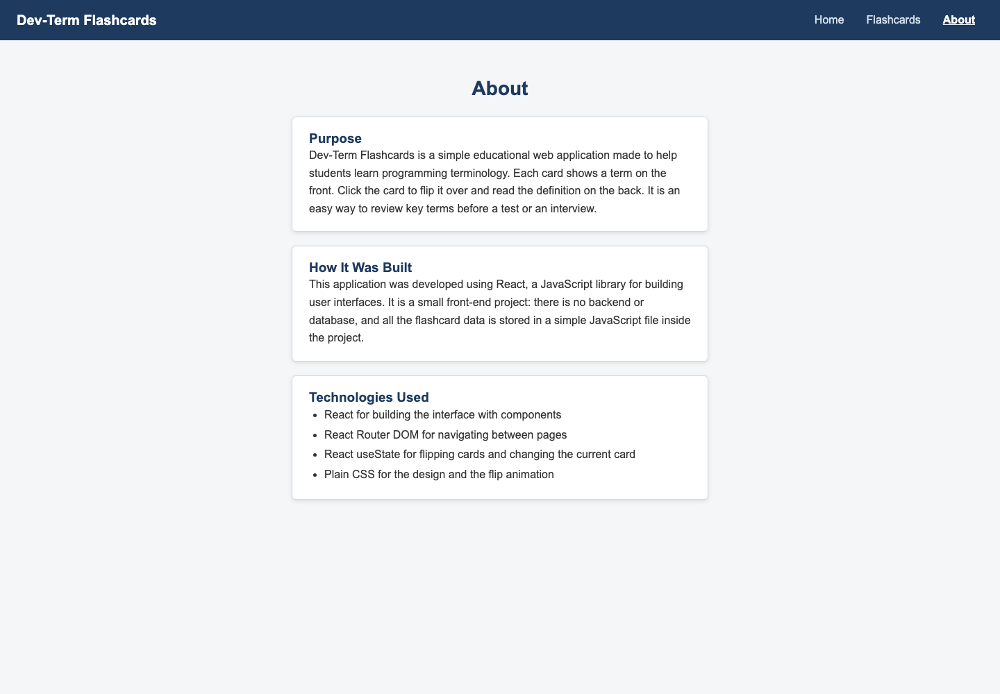

# Dev-Term Flashcards

A beginner-friendly React app for learning programming terminology with interactive flashcards. Each card shows a term on the front and its definition when flipped.

## Screenshots

### Home



### Flashcards



### About



## Features

- Browse programming terms one card at a time
- Flip a card to reveal its definition
- Move to the previous or next card
- Shuffle the deck
- Navigate between Home, Flashcards, and About pages

## Built with

- React and JavaScript (JSX)
- Vite
- React Router
- CSS

## Getting started

You need Node.js and npm installed.

1. Open a terminal in this project folder.
2. Install dependencies:

   ```bash
   npm ci
   ```

3. Start the development server:

   ```bash
   npm run dev
   ```

4. Open the local URL printed in the terminal (usually [http://localhost:5173](http://localhost:5173)).

To stop the server, press **Ctrl+C** in the terminal.

## Project structure

```text
src/
├── components/       Reusable UI components, including the navbar and flashcard
├── data/             Flashcard terms and definitions
├── pages/            Home, Flashcards, and About pages
├── App.jsx           Shared layout and route definitions
├── App.css           App-level styles
└── index.css         Global styles
```

## How the flashcards work

The terms and definitions are stored in `src/data/flashcards.js` as an array. The Flashcards page uses React's `useState` hook to track the current deck order, the selected card index, and whether the card is flipped. Clicking a card updates the flip state. Previous and Next update the selected index and reset the card to its front. Shuffle randomizes a copy of the deck and starts again at the first card. CSS provides the card's visual flip animation.

## Available scripts

- `npm run dev` — start the local development server
- `npm run build` — create a production build in `dist/`
- `npm run preview` — preview the production build locally
- `npm run lint` — run ESLint
- `npm run typecheck` — run the configured TypeScript check (this project’s app code is JavaScript/JSX)
